<!-- Grafo de contribuciones con datos reales; lo regenera a diario
     .github/workflows/update-profile-art.yml (python3 scripts/build.py) -->

<h3><code>anthony@github ~ $ ./contribuciones.sh</code></h3>

 
 

<!-- Retrato (local: scripts/portrait.py) y ficha (diaria: scripts/build.py).
     Ambos SVG miden 840x880: mismo ancho, misma altura. -->

<h3><code>anthony@github ~ $ whoami</code></h3>

<table>
<tr>
<td valign="top"></td>
<td valign="top"></td>
</tr>
</table>

 
 

<h3><code>anthony@github ~ $ ./contacto.sh</code></h3>

<b>Arquitecto y consultor de software · DevOps · Seguridad</b>

 

